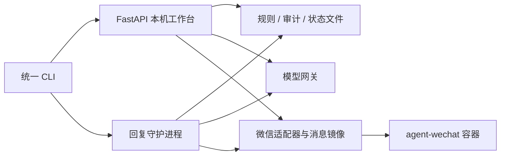

# 架构与行为约定

`wechat_ai_reply.py` 封装 REST 读取、解锁状态、消息分类、模型调用及容器内发送。发送自动追加 AI 标记，结合目标聊天校验、互斥锁及消息验证。它不操作宿主微信窗口。

`wechat_ai_daemon.py` 负责轮询、上下文组织、规则优先级、群聊概率和冷却、限流、状态保存和 writer 所有权。shadow 模式不发送、也不确认待处理消息。live 模式通过标记文件声明发送者所有权。

`wechat_ai_control/` 包含规则与运行配置的原子写入、SQLite 审计、模型服务和路由、聊天数据镜像、消息展示与操作确认。规则更改可以预览和回滚。配置包含保存版本和实际加载版本两套状态，便于发现未生效配置。

手动发送不会解锁联系人。解锁关键词、显式人工授权和人工撤销属于独立操作；模型解析器不能自行新增解锁权限。

`interaction.py`、`vm_window.py`、`vm_activity.py`、`transfer.py` 保留旧项目的人机交互仲裁与文件传输观察能力。默认 `observe_only` 表示只观测，并非已经执行发送拦截；只有显式 `enforce` 才走发送守卫。未知虚拟机状态在 enforce 下会阻止发送。该部分依赖外部 VM 状态源，属于实验功能，不是普通 Docker 模式的必要前提。

模型服务密钥保存在系统凭据存储中，旧版 SiliconFlow JSON 是兼容路径。真正聊天、待回复队列、数据库密钥和日志都属于运行数据，与源码分离。
